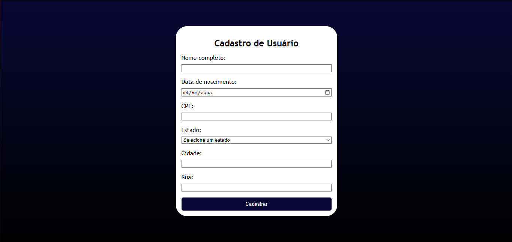

# Sistema de Cadastramento

Projeto acadêmico desenvolvido para praticar desenvolvimento web e integração com banco de dados.



## Tecnologias utilizadas

- **HTML5** — estrutura da página.
- **CSS3** — estilização e animações da interface.
- **JavaScript** — validação e envio dos dados do formulário.
- **Node.js** — execução do servidor.
- **Express** — criação da API para receber os cadastros.
- **PostgreSQL** — armazenamento dos dados.
- **Git e GitHub** — versionamento e publicação do código.

## Funcionalidades

- Formulário para cadastro de pessoas.
- Validação de campos obrigatórios.
- Validação do formato do CPF.
- Verificação de CPF duplicado.
- Integração entre o formulário, o servidor e o banco de dados.
- Armazenamento dos cadastros no PostgreSQL.

## Como executar

1. Instale o [Node.js](https://nodejs.org/) e o PostgreSQL.
2. Clone este repositório.
3. Instale as dependências:

   ```bash
   npm install
   ```

4. Configure as variáveis de ambiente no arquivo `.env`, seguindo os nomes definidos no projeto.
5. Crie o banco de dados e a tabela `pessoas`, conforme a estrutura utilizada no código.
6. Inicie o servidor:

   ```bash
   node server.js
   ```

7. Acesse a aplicação conforme a configuração do projeto.

## Objetivo

Praticar conceitos de desenvolvimento web, APIs, validação de dados, operações com banco de dados e organização de projetos.

---

Projeto desenvolvido para fins educacionais.
